<!-- Generated by scripts/build.ts from templates/README.tpl.md and config/profile.yml. Do not edit by hand. -->


<picture><source media="(prefers-color-scheme: dark)" srcset="assets/generated/hero-dark.svg"><source media="(prefers-color-scheme: light)" srcset="assets/generated/hero-light.svg"></picture>

I turn agentic AI from a demo into something that actually runs the business: **Microsoft Foundry**, **Copilot Studio**, **Microsoft 365 Copilot**, **Power Platform**, and **Azure**.

30+ years in IT across engineering, architecture, and customer-facing leadership. Most of what you'll find here started as a real customer problem.

[`~/site` russrimmerman.com](https://www.russrimmerman.com) &nbsp;·&nbsp; [`~/in` LinkedIn](https://www.linkedin.com/in/russrimm) &nbsp;·&nbsp; [`~/pulse` Pulse 360°](https://www.mspulse360.app) &nbsp;·&nbsp; [`~/book` The Agentic Advantage](https://github.com/russrimm/AgenticAdvantageGuide)

<br>

<picture><source media="(prefers-color-scheme: dark)" srcset="assets/generated/pstree-dark.svg"><source media="(prefers-color-scheme: light)" srcset="assets/generated/pstree-light.svg"></picture>

<br>

<p>
<picture><source media="(prefers-color-scheme: dark)" srcset="assets/generated/rule-agents-dark.svg"><source media="(prefers-color-scheme: light)" srcset="assets/generated/rule-agents-light.svg"></picture>
</p>

<p align="center">
<a href="https://github.com/russrimm/Pulse360"><picture><source media="(prefers-color-scheme: dark)" srcset="assets/generated/card-pulse360-dark.svg"><source media="(prefers-color-scheme: light)" srcset="assets/generated/card-pulse360-light.svg"></picture></a>
</p>

<p align="center">
<a href="https://github.com/russrimm/MicrosoftCommunicationsPortal"><picture><source media="(prefers-color-scheme: dark)" srcset="assets/generated/card-microsoftcommunicationsportal-dark.svg"><source media="(prefers-color-scheme: light)" srcset="assets/generated/card-microsoftcommunicationsportal-light.svg"></picture></a>
<a href="https://github.com/russrimm/EconoMonitor"><picture><source media="(prefers-color-scheme: dark)" srcset="assets/generated/card-economonitor-dark.svg"><source media="(prefers-color-scheme: light)" srcset="assets/generated/card-economonitor-light.svg"></picture></a>
</p>

<p align="center">
<a href="https://github.com/russrimm/copilot-decision-guidance"><picture><source media="(prefers-color-scheme: dark)" srcset="assets/generated/card-copilot-decision-guidance-dark.svg"><source media="(prefers-color-scheme: light)" srcset="assets/generated/card-copilot-decision-guidance-light.svg"></picture></a>
<a href="https://github.com/russrimm/Copilot-Studio-Azure-AI-Foundry-Agile-Framework"><picture><source media="(prefers-color-scheme: dark)" srcset="assets/generated/card-copilot-studio-azure-ai-foundry-agile-framework-dark.svg"><source media="(prefers-color-scheme: light)" srcset="assets/generated/card-copilot-studio-azure-ai-foundry-agile-framework-light.svg"></picture></a>
</p>

<p align="center">
<a href="https://github.com/russrimm/CopilotStudioLabs"><picture><source media="(prefers-color-scheme: dark)" srcset="assets/generated/card-copilotstudiolabs-dark.svg"><source media="(prefers-color-scheme: light)" srcset="assets/generated/card-copilotstudiolabs-light.svg"></picture></a>
<a href="https://github.com/russrimm/Vibe-Coding-101"><picture><source media="(prefers-color-scheme: dark)" srcset="assets/generated/card-vibe-coding-101-dark.svg"><source media="(prefers-color-scheme: light)" srcset="assets/generated/card-vibe-coding-101-light.svg"></picture></a>
</p>

<p align="center">
<a href="https://github.com/russrimm/Oil-Gas-CodeFirst"><picture><source media="(prefers-color-scheme: dark)" srcset="assets/generated/card-oil-gas-codefirst-dark.svg"><source media="(prefers-color-scheme: light)" srcset="assets/generated/card-oil-gas-codefirst-light.svg"></picture></a>
</p>

<br>

<picture><source media="(prefers-color-scheme: dark)" srcset="assets/generated/monitor-dark.svg"><source media="(prefers-color-scheme: light)" srcset="assets/generated/monitor-light.svg"></picture>

<br>

<a href="https://github.com/russrimm/AgenticAdvantageGuide"><picture><source media="(prefers-color-scheme: dark)" srcset="assets/generated/book-dark.svg"><source media="(prefers-color-scheme: light)" srcset="assets/generated/book-light.svg"></picture></a>

<br>

<p>
<picture><source media="(prefers-color-scheme: dark)" srcset="assets/generated/rule-feed-dark.svg"><source media="(prefers-color-scheme: light)" srcset="assets/generated/rule-feed-light.svg"></picture>
</p>

<code>2026-09-24</code> &nbsp;[Open Notebook: A Self-Hosted AI Research Notebook](https://www.russrimmerman.com/blog/open-notebook-self-hosted-research-notebook/)<br>
<code>2026-09-17</code> &nbsp;[I Had 27 MCP Servers and Four Doing the Same Job. So I Built AI Harness Helper](https://www.russrimmerman.com/blog/ai-harness-helper/)<br>
<code>2026-09-16</code> &nbsp;[Managing GitHub Copilot Credit Consumption](https://www.russrimmerman.com/blog/managing-github-copilot-credit-consumption/)<br>
<code>2026-09-09</code> &nbsp;[Sync ALL your Copilot Studio conversation transcripts to a single location](https://www.russrimmerman.com/blog/copilot-studio-transcript-replication/)<br>
<code>2026-09-08</code> &nbsp;[Estimating Copilot Studio Costs: A FinOps Playbook](https://www.russrimmerman.com/blog/estimating-copilot-studio-agent-costs/)

<sub>↳ [all posts](https://www.russrimmerman.com/blog/) · [RSS](https://www.russrimmerman.com/rss.xml)</sub>

<br>

<p>
<picture><source media="(prefers-color-scheme: dark)" srcset="assets/generated/rule-projects-dark.svg"><source media="(prefers-color-scheme: light)" srcset="assets/generated/rule-projects-light.svg"></picture>
</p>

#### `./production-grade-platforms`

| Project | What it is | ★ | Lang | Pushed |
|---|---|---:|---|---|
| **[NHTSA Automotive Analyzer](https://github.com/russrimm/nhtsa)** · [live ↗](https://nhtsa-silk.vercel.app) | Every major NHTSA public API — VIN decoding, safety ratings, recalls, complaints, investigations — in one UI. | 0 | TypeScript | 4mo&nbsp;ago |
| **[russrimmerman.com](https://github.com/russrimm/Russ-Rimmerman-Blog)** · [live ↗](https://www.russrimmerman.com) | My blog and portfolio. Astro, MDX, Tailwind CSS, Azure Static Web Apps. | 0 | MDX | 4d&nbsp;ago |

#### `./frameworks-and-decision-guidance`

| Project | What it is | ★ | Lang | Pushed |
|---|---|---:|---|---|
| **[The Agentic Advantage — companion guide](https://github.com/russrimm/AgenticAdvantageGuide)** | Companion website for the book. | 0 | HTML | 3mo&nbsp;ago |
| **[Copilot Studio Kit walkthrough](https://github.com/russrimm/copilot-studio-kit-walkthrough)** | End-to-end install and configuration guide for the Microsoft Copilot Studio Kit. | 0 | — | 3mo&nbsp;ago |

#### `./labs-and-enablement`

| Project | What it is | ★ | Lang | Pushed |
|---|---|---:|---|---|
| **[Agent SDK Demo](https://github.com/russrimm/AgentSDKDemo)** | TypeScript/Node.js Direct to Engine client for Copilot Studio agents, with service principal and interactive auth. | 0 | TypeScript | 11mo&nbsp;ago |
| **[Copilot Studio + Snowflake knowledge](https://github.com/russrimm/CopilotStudioSnowflakeKnowledge)** | Configuring Snowflake as a Copilot Studio knowledge source. | 1 | — | 11mo&nbsp;ago |

#### `./automation-accelerators`

| Project | What it is | ★ | Lang | Pushed |
|---|---|---:|---|---|
| **[App secret & certificate expiration alerts](https://github.com/russrimm/AADAppSecretsnCertsExpirationNotification)** | Proactively notifies Microsoft Entra ID admins before client secrets and certificates expire. | 48 | — | 2y&nbsp;ago |
| **[Power Platform & Copilot Studio news automation](https://github.com/russrimm/Power-Platform-Copilot-Studio-News-Automation)** | Gathers blog, YouTube, and service message updates, summarizes them, and emails a digest. | 1 | HTML | 9mo&nbsp;ago |
| **[Product news automation](https://github.com/russrimm/ProductNewsAutomation)** | RSS and Microsoft 365 Message Center digest flow for a configurable product list. | 1 | — | 1y&nbsp;ago |
| **[Power Platform + Application Insights](https://github.com/russrimm/PowerPlatformAppInsights)** | Wiring Power Platform telemetry into Application Insights. | 1 | — | 8mo&nbsp;ago |

<sub>Some of these are deliberate prototypes for fast validation; others are hardened for enterprise, mission-critical use. Each repo's README says which, along with its architecture, prerequisites, and deployment path.</sub>

<br>

<details>
<summary><code>▸ cat stack.json</code></summary>

```json
{
  "agents":    ["Microsoft Foundry", "Copilot Studio", "Microsoft 365 Copilot", "GitHub Copilot"],
  "platform":  ["Power Platform", "Dataverse", "Power Automate", "Power Apps code apps", "PCF"],
  "cloud":     ["Azure App Service", "Static Web Apps", "Container Apps", "Azure Monitor", "Bicep"],
  "languages": ["TypeScript", "JavaScript", "Python", "PowerShell", "C#"],
  "web":       ["React", "Next.js", "Node.js", "Vite", "Tailwind CSS", "Astro", "Flask"],
  "principle": "the profile you're reading is rebuilt nightly by its own pipeline"
}
```
</details>

<details>
<summary><code>▸ man russrimm</code></summary>

- Principal Cloud Solution Architect, Microsoft — Power Platform / Low Code
- Previously Senior Customer Engineer and Senior Technical Account Manager at Microsoft
- Co-author of Microsoft Press field experience content in systems management and update management
- Author of **The Agentic Advantage**
- Regular technical contributor with hands-on demos and walkthroughs for Copilot Studio, Microsoft Foundry, and cloud automation

If you're working on **agentic automation, Microsoft Foundry adoption, Power Platform strategy, or cloud modernization**, I'd love to compare notes.
</details>

---

<sub>`russ@foundry:~$` &nbsp;[russrimmerman.com](https://www.russrimmerman.com) &nbsp;·&nbsp; [in/russrimm](https://www.linkedin.com/in/russrimm) &nbsp;·&nbsp; 📍 Cypress, TX &nbsp;·&nbsp; rebuilt 2026-09-29 by [`refresh.yml`](.github/workflows/refresh.yml)</sub>

<sub><i>Personal projects and opinions. Not official Microsoft guidance, product, or support.</i></sub>
